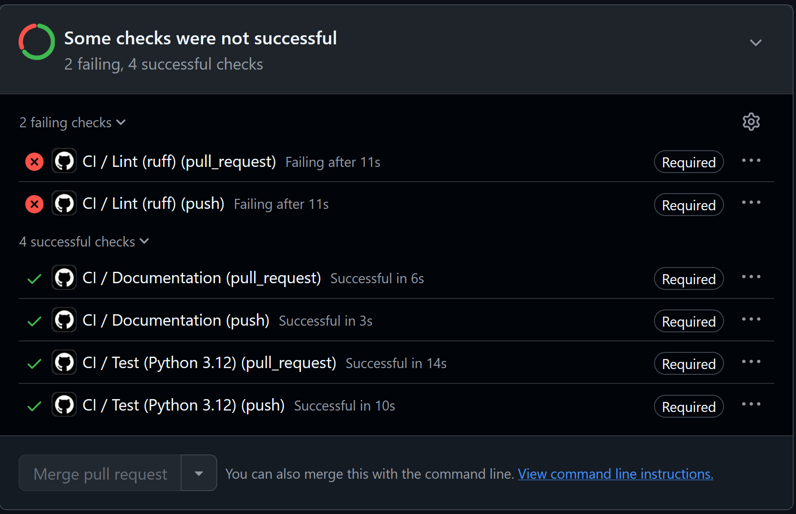
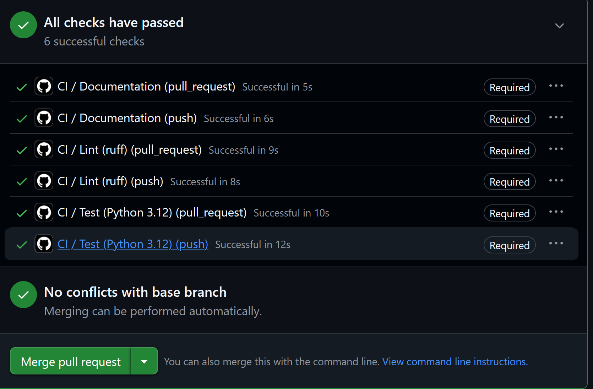

# Project evidence

## CI gate demonstration

This records the red-to-green demonstration in
[PR #2](https://github.com/nadlerfabian/devops-gradebook/pull/2).
The screenshots were captured and supplied by the project owner.

### Deliberate failure

[Commit dea8b2f](https://github.com/nadlerfabian/devops-gradebook/commit/dea8b2f)
added an unused `import os` to `app/routes.py` to trigger Ruff's unused-import
check. The screenshot shows failed required Lint checks, passing Test and
Documentation checks, and a disabled merge button.

### Repair

[Commit c468ff2](https://github.com/nadlerfabian/devops-gradebook/commit/c468ff2)
removed the deliberate violation. The screenshot shows all six checks passing,
each marked Required, and the merge button enabled.

Each job appears twice because CI runs for both push and pull-request events.
This is not six different test suites: Documentation, Lint, and Test each run
twice.

The screenshots record those demonstration commits, before the final evidence
documentation commit. CI must pass again on the final PR revision before merge;
there is no need to recapture the same demonstration for each documentation
update. These screenshots prove the demonstrated lint gate, not completion of
Docker builds, security scans, or the other final-project requirements.

## Week 7 Terraform lifecycle

The [terminal transcript](terraform-lifecycle.txt) records the owner's run
on 8 November 2026. The local checkout path was removed from the prompts.

- The apply plan showed one Gradebook container to create.
- Apply created the container and reported `http://127.0.0.1:8081`.
- The health endpoint returned status `ok` and version `terraform-local`.
- A second plan reported no changes.
- Destroy reported one resource destroyed.
